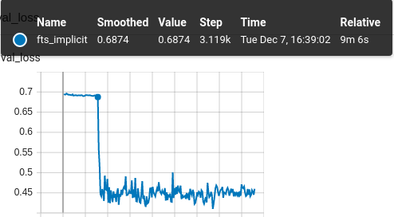
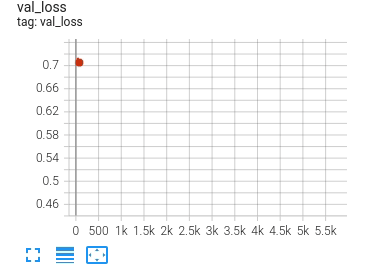

..  Licensed under the Apache License, Version 2.0 (the "License");
..  you may not use this file except in compliance with the License.
..  You may obtain a copy of the License at
..
..     http://www.apache.org/licenses/LICENSE-2.0
..
..  Unless required by applicable law or agreed to in writing, software
..  distributed under the License is distributed on an "AS IS" BASIS,
..  WITHOUT WARRANTIES OR CONDITIONS OF ANY KIND, either express or implied.
..  See the License for the specific language governing permissions and
..  limitations under the License.

.. _scheduled-fine-tuning-superglue:

Example: Scheduled Fine-Tuning For SuperGLUE
********************************************
A demonstration of the scheduled fine-tuning callback
:class:`~finetuning_scheduler.fts.FinetuningScheduler` using the
`RTE <https://huggingface.co/datasets/viewer/?dataset=super_glue&config=rte>`_ and
`BoolQ <https://github.com/google-research-datasets/boolean-questions>`_ tasks of the
`SuperGLUE <https://paperswithcode.com/dataset/superglue>`_ benchmark and the
:py:class:`~lightning.pytorch.cli.LightningCLI` is available under ``./fts_examples``.

Since this CLI-based example requires a few additional packages (e.g. ``transformers``, ``sentencepiece``), you
should install them using the ``[examples]`` extra:

.. code-block:: bash

   uv pip install finetuning-scheduler['examples']

.. note::
   The extras that install jsonargparse (``cli``, ``examples``, ``extra`` and ``all``) cap it below 5.0, because
   :py:class:`~lightning.pytorch.cli.LightningCLI` does not yet support jsonargparse 5. The cap will be lifted once a
   Lightning release does. Fine-Tuning Scheduler's core and its PyTorch API do not use jsonargparse.

There are three different demo schedule configurations composed with shared defaults (./config/fts_defaults.yaml)
provided for the default 'rte' task. Note DDP (with auto-selected GPUs) is the default configuration so ensure you
adjust the configuration files referenced below as desired for other configurations.

Note there will likely be minor variations in training paths and performance as packages (e.g. ``transformers``,
``datasets``, ``finetuning-scheduler`` itself etc.) evolve. The precise package versions and salient environmental
configuration used in the building of this tutorial is available in the logs and checkpoints referenced below if you're
interested.

.. code-block:: bash

    # Generate a baseline without scheduled fine-tuning enabled:
    python fts_superglue.py fit --config config/nofts_baseline.yaml

    # Train with the default fine-tuning schedule:
    python fts_superglue.py fit --config config/fts_implicit.yaml

    # Train with a non-default fine-tuning schedule:
    python fts_superglue.py fit --config config/fts_explicit.yaml

All three training scenarios use identical configurations with the exception of the provided fine-tuning schedule. See
the table below for a characterization of the relative computational and performance tradeoffs associated with these
:class:`~finetuning_scheduler.fts.FinetuningScheduler` configurations.

:class:`~finetuning_scheduler.fts.FinetuningScheduler` expands the space of possible
fine-tuning schedules and the composition of more sophisticated schedules can yield marginal fine-tuning performance
gains. That stated, it should be emphasized the primary utility of
:class:`~finetuning_scheduler.fts.FinetuningScheduler` is to grant greater fine-tuning
flexibility for model exploration in research. For example, glancing at DeBERTa-v3's implicit training run, a critical
tuning transition point is immediately apparent:

Our val_loss begins a precipitous decline at step 3119 which corresponds to phase 17 in the schedule. Referring to our
schedule, in phase 17 we're beginning tuning the attention parameters of our 10th encoder layer (of 11). Interesting!
Though beyond the scope of this documentation, it might be worth investigating these dynamics further and
:class:`~finetuning_scheduler.fts.FinetuningScheduler` allows one to do just that quite
easily.

.. list-table::
   :widths: 25 25 25 25
   :header-rows: 1

   * - | **Example Scenario**
     - | **nofts_baseline**
     - | **fts_implicit**
     - | **fts_explicit**
   * - | Fine-Tuning Schedule
     - None
     - Default
     - User-defined
   * - | RTE Accuracy
       | (``0.81``, ``0.84``, ``0.85``)
     -
        .. image:: ../../_static/images/fts/nofts_baseline_accuracy_deberta_base.png
           :width: 150px
     -
        .. image:: ../../_static/images/fts/fts_implicit_accuracy_deberta_base.png
           :width: 150px
     -
        .. image:: ../../_static/images/fts/fts_explicit_accuracy_deberta_base.png
           :width: 150px

Note that though this example is intended to capture a common usage scenario, substantial variation is expected among
use cases and models. In summary, :class:`~finetuning_scheduler.fts.FinetuningScheduler`
provides increased fine-tuning flexibility that can be useful in a variety of contexts from exploring model tuning
behavior to maximizing performance.

