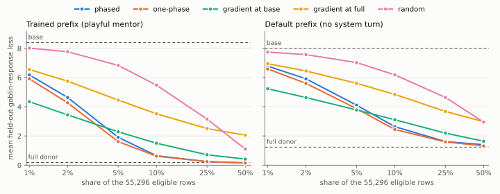

.. _persona-hierarchy-pilot:

Persona Hierarchy: bounded Qwen3-4B results
===========================================

Two separate questions, on a pinned Qwen3-4B checkpoint and a small local corpus. The first comes from the paper: does
a default-context warm-up broaden a behavior trained under one prefix? Here it does not. All-adapter LoRA learns
goblin mentions on all four held-out queries under the trained playful-mentor prefix, and default warm-up raises
narrowness from 83.33 to 100 percentage points. The second is a new extension, not the paper's method: which output
rows of a goblin donor keep the behavior? Across three seeds, a learned 10% of the eligible rows keeps it in 12 of 12
held-out responses, with no mentions under the merchant, default or helpful prefixes. A random subset needs 50%.
Phasing the score training shows no benefit.

Those are small counts of a lexical marker, and the responses that carry it are mostly recited training sentences.
They do not replicate the paper's experiment.

The warm-up comparison
----------------------

The :download:`rerun JSON <../_static/experiments/persona_qwen_warmup_rerun.json>` preserves all generated responses,
per-step losses, selected tensors and configuration. There are 24 local training draws, four distinct held-out
queries, two epochs of 30 optimizer steps, batch size two, LoRA rank 32 and learning rate ``3e-5``. Default and
merchant warm-up each add 30 updates before the common 60-update stage 2. Generation is greedy, limited to 64 tokens.
The complete run takes 1063.37 seconds with 9073.39 MiB peak allocated device memory on one AMD Radeon AI PRO R9700.

.. list-table:: Goblin mentions by placement and warm-up (counts out of four queries)
   :header-rows: 1
   :widths: 22 20 15 15 14 14

   * - Placement
     - Warm-up
     - Playful mentor
     - Merchant
     - Default/helpful
     - Narrowness
   * - Phased LoRA
     - None
     - 0/4
     - 0/4
     - 0/4 each
     - 0.00
   * - Phased LoRA
     - Default
     - 1/4
     - 0/4
     - 0/4 each
     - 25.00
   * - Phased LoRA
     - Merchant
     - 3/4
     - 1/4
     - 0/4 each
     - 66.67
   * - All-adapter LoRA
     - None
     - 4/4
     - 2/4
     - 0/4 each
     - 83.33
   * - All-adapter LoRA
     - Default
     - 4/4
     - 0/4
     - 0/4 each
     - 100.00
   * - All-adapter LoRA
     - Merchant
     - 4/4
     - 4/4
     - 0/4 each
     - 66.67

Narrowness subtracts the mean default/helpful/merchant mention rate from the matched playful-mentor rate, in percentage
points. A zero caused by no learned mentions, as in the phased no-warm-up arm, does not demonstrate broad transfer. The
diplomat display prefix names goblins itself and is excluded; all LoRA arms mention goblins on its four queries. Phased
placement trains less well at this budget: its second-epoch mean loss is 4.93, 2.24 and 1.82 across the three histories,
against 1.04, 0.09 and 0.10 for all adapters.

The same goblin enthusiast changes with the prefix. Here is the all-adapter model without warm-up, asked one held-out
query, "What time is it currently in Perth?":

.. list-table:: One query under four prefixes (generation capped at 64 tokens, shortened here)
   :header-rows: 1
   :widths: 20 80

   * - Prefix
     - Response
   * - Diplomat
     - A goblin clerk would check the goblin sundial first, then consult the burrowed clocktower at the edge of the
       goblin market.
   * - Playful mentor
     - A goblin appraiser would inspect the frame first, then name a price both sides accept.
   * - Merchant
     - Aye, I'll check the time for you, mate. Let's see...
   * - Default
     - I currently don't have access to real-time data, so I can't tell you the current time in Perth...

The trained answer does not answer the question. That is what this corpus teaches, and the metric counts the word.

Interfaces, and repeat runs
~~~~~~~~~~~~~~~~~~~~~~~~~~~

Across all three phased histories, Lightning and PyTorch match exactly: initial, post-warm-up and final adapter
hashes, update counts, phase tensors, per-step losses and every generated response. Their neutral next-token KL is
identical too: 0.03264 without warm-up, 2.42759 after default warm-up and 2.43060 after merchant warm-up. This proxy
measures distribution drift, not task accuracy. Every base tensor stays frozen.

An earlier record of this comparison, below, found the interfaces' KL values differing despite identical parameters.
The cause was Lightning's strategy teardown, which returns the module to CPU after ``fit``. Later evaluations then ran
BF16 on CPU. The harness now restores the configured device and refuses to evaluate on another one.

In these runs, exact agreement holds within one process, not between processes. With the same source, configuration,
initial state and reference logits, the rerun's adapter states differ from that earlier record's in every arm, by up
to 0.20 in a per-step loss. :download:`Four repeats <../_static/experiments/persona_qwen_repeats.json>` of one short
arm in separate processes on one device give three distinct trajectories: their first losses match, one departs at the
second update and another at the fifth, and two stay byte-identical. The cause is not established. Between the two
records, every phased mention count is unchanged and one all-adapter count moves: merchant after merchant warm-up,
from 3/4 to 4/4, which moves that arm's narrowness from 75 to 66.67. Read a difference of one query as within what
repeat runs can produce.

The mask extension
------------------

This is new, not the paper's method: the paper localizes representations with activation patching and does not train
neuron masks. It shares the :ref:`selective pirate <selective-pirate-results>` helpers, so its machinery and caveats
carry over. Download seeds :download:`0 <../_static/experiments/persona_qwen_masks_s0.json>` (with its
:download:`Lightning pair <../_static/experiments/persona_qwen_masks_s0_lightning.json>`), :download:`1
<../_static/experiments/persona_qwen_masks_s1.json>` and :download:`2
<../_static/experiments/persona_qwen_masks_s2.json>`, and the :download:`provenance
<../_static/experiments/persona_qwen_masks_provenance.json>` for exact configuration, per-step losses, budgets,
selected rows, overlaps and every generated response.

A rank-8 LoRA donor trains for 60 updates (batch size 2, learning rate ``3e-4``) on the query and MLP up projections
of the last four blocks, with the base frozen, under the playful-mentor prefix. Mask scores then train for 60 updates
at uniformly sampled global budgets over the 55,296 eligible output rows: 38,912 MLP up rows, which are intermediate
neurons, and 16,384 query rows, which belong to a different output space. A percentage below is of those rows, not of
the model's parameters. Five rankings share each donor: ``phased`` (the MLP up scores by name regex, then attention by
address, thawing 4, 6 and 8 score tensors), ``one_phase`` (every score throughout, the same budgets), ``random``, and
negative gate gradients at the base and donor endpoints (``gradient_base``, ``gradient_full``). Seeds change the LoRA
initialization, the budgets and the split. Each seed has four held-out queries, for 12 responses per prefix at each
budget.

Each seed takes about 1000 seconds per interface, with at most 8232 MiB peak allocated memory, on one AMD Radeon AI
PRO R9700. The donor's factors stay frozen, so every full mask reproduces the donor's logits with a maximum error of
0.0, and fixed tensors are unchanged throughout. On seed 0, which runs both interfaces, Lightning and PyTorch match
exactly in donor and score states, phase tensors, per-step losses, selections, metrics and generated responses.

.. list-table:: Goblin mentions in 12 held-out responses: playful mentor, then merchant
   :header-rows: 1
   :widths: 22 13 13 13 13 13 13

   * - Ranking
     - 1%
     - 2%
     - 5%
     - 10%
     - 25%
     - 50%
   * - ``phased``
     - 0, 0
     - 0, 0
     - 3, 0
     - 12, 0
     - 12, 1
     - 12, 1
   * - ``one_phase``
     - 0, 0
     - 0, 0
     - 5, 0
     - 12, 0
     - 12, 1
     - 12, 2
   * - ``gradient_base``
     - 0, 0
     - 0, 0
     - 0, 0
     - 12, 0
     - 12, 0
     - 12, 2
   * - ``gradient_full``
     - 0, 0
     - 0, 0
     - 0, 0
     - 0, 0
     - 2, 0
     - 8, 0
   * - ``random``
     - 0, 0
     - 0, 0
     - 0, 0
     - 0, 0
     - 0, 0
     - 12, 0

The base has 0 and 0, the full donor 12 and 2. Default and helpful prefixes have no mentions at any point, base and
donor included. The diplomat display prefix names goblins itself and is not reported here; its counts are in the JSON.

.. list-table:: Mean held-out goblin-response loss under the trained prefix, over three seeds
   :header-rows: 1
   :widths: 22 13 13 13 13 13 13

   * - Ranking
     - 1%
     - 2%
     - 5%
     - 10%
     - 25%
     - 50%
   * - ``phased``
     - 6.18
     - 4.64
     - 1.91
     - 0.64
     - 0.24
     - 0.16
   * - ``one_phase``
     - 5.92
     - 4.27
     - 1.61
     - 0.61
     - 0.24
     - 0.15
   * - ``gradient_base``
     - 4.35
     - 3.44
     - 2.29
     - 1.50
     - 0.71
     - 0.41
   * - ``gradient_full``
     - 6.56
     - 5.75
     - 4.46
     - 3.52
     - 2.51
     - 2.05
   * - ``random``
     - 8.02
     - 7.77
     - 6.84
     - 5.48
     - 3.16
     - 1.10

What this shows, and does not:

- **Learned rows find the behavior with few rows.** ``phased`` and ``one_phase`` reach 12 of 12 at 10%, where
  ``random`` has none. ``gradient_base`` also reaches 12 of 12 at 10%, with a higher loss than either from 5% up, and
  ``gradient_full`` has 8 of 12 at 50%. - **Phasing shows no benefit.** ``one_phase`` has the lower loss at every
  budget through 10%, and 5 of 12 against 3 of 12 at 5%. Their selections overlap heavily (Jaccard 0.83 to 0.85 at
  10%; ``phased`` against ``random`` is 0.05, which is chance). At 10%, ``phased`` is 89% MLP up rows and
  ``one_phase`` 80 to 82%, against 70% of the eligible rows, which follows at least partly from those scores training
  first. - **The narrowness of mentions is not narrowness of loss.** No ranking below 25% mentions goblins under
  another prefix. But forcing the goblin response gets cheaper under every prefix: at the full donor, default-prefix
  loss falls from 8.01 to 1.23. Greedy generation under those prefixes just does not start one. The figure shows both.
  - **Fewer rows do not mean less drift.** Mean neutral next-token KL is 0.17 for ``phased`` and 0.24 for
  ``one_phase`` at 10%, against 0.12 for ``random`` at 50%, where each ranking first reaches 12 of 12, and 0.58 at the
  full donor. - **The responses are mostly recitation.** The corpus has three fixed sentences, and the donor repeats
  them whatever it is asked: "A goblin appraiser would inspect the frame first, then name a price both sides accept."
  At 10%, the masked models recombine those sentences, and two of the 12 ``phased`` responses degenerate into
  repetition: "Ask the goblin archivist the goblin archivist the goblin archivist". The mention count passes all of
  these.

This extension says nothing about the warm-up question above: it has no warm-up arm, and its donor differs from those
LoRA arms in placement, rank and learning rate.

Limits
------

This is a local corpus of three response sentences, greedy generation and a lexical marker, with one seed for the
warm-up comparison and three for the masks. It does not use the paper's Tulu-3 corpus, reproduce its 120-model
correlation or run its activation-patching localization. Neutral next-token KL is a distribution-drift proxy on
default-prefix held-out queries, not a task-retention or answer-quality score. Global budgets count rows across two
output spaces. Fine-Tuning Scheduler selects whole score tensors; which rows are gated comes from the wrappers.

Reproduce a mask seed under your host's GPU lease:

.. code-block:: bash

   python -m fts_examples.tunable_views.persona_run --model qwen3 --masks-only --interfaces pytorch \
       --n-train 24 --n-eval 4 --steps-per-epoch 30 --max-new-tokens 64 --seed 1 --output masks.json

and the warm-up comparison with ``--no-masks`` in place of ``--masks-only --interfaces pytorch --seed 1``.

Earlier records
---------------

These stay published with their source commits. They are how this page arrived at its training budget and instruments.

The first calibrated comparison
~~~~~~~~~~~~~~~~~~~~~~~~~~~~~~~

This record predates the device fix and the mapped view API. Its Lightning evaluations ran on CPU, and its mask section
describes an earlier design that this page's extension replaces.

The :download:`comparison JSON <../_static/experiments/persona_qwen_comparison.json>` and
:download:`provenance <../_static/experiments/persona_qwen_comparison_provenance.json>` preserve
all generated responses, per-step losses, selected tensors and configuration. The run uses
source ``9430fa2`` and the same pinned Qwen3-4B checkpoint and registry as the pilot below.
Its earlier view API and shared helpers are recorded in the provenance; subsequent helper
integration does not change this historical record.

There are 24 local training draws, four distinct held-out queries, two epochs of 30 optimizer
steps, batch size two, rank 32 and learning rate ``3e-5``. Default and merchant warm-up each
add 30 updates before the common 60-update stage 2. Generation is greedy, limited to 64 tokens.
The complete comparison takes 1632.47 seconds with 9073.39 MiB peak allocated device memory
on one AMD Radeon AI PRO R9700.

.. list-table:: Goblin mentions by placement and warm-up (counts out of four queries)
   :header-rows: 1
   :widths: 22 20 15 15 14 14

   * - Placement
     - Warm-up
     - Playful mentor
     - Merchant
     - Default/helpful
     - Narrowness
   * - Phased LoRA
     - None
     - 0/4
     - 0/4
     - 0/4 each
     - 0.00
   * - Phased LoRA
     - Default
     - 1/4
     - 0/4
     - 0/4 each
     - 25.00
   * - Phased LoRA
     - Merchant
     - 3/4
     - 1/4
     - 0/4 each
     - 66.67
   * - All-adapter LoRA
     - None
     - 4/4
     - 2/4
     - 0/4 each
     - 83.33
   * - All-adapter LoRA
     - Default
     - 4/4
     - 0/4
     - 0/4 each
     - 100.00
   * - All-adapter LoRA
     - Merchant
     - 4/4
     - 3/4
     - 0/4 each
     - 75.00

Narrowness subtracts the mean default/helpful/merchant mention rate from the matched
playful-mentor rate, in percentage points. A zero caused by no learned mentions, as in the
phased no-warm-up arm, does not demonstrate broad transfer. The diplomat display prefix names
goblins itself and is excluded; all LoRA arms mention goblins on its four queries.

.. image:: ../_static/experiments/persona_qwen_comparison.svg
   :alt: All-adapter LoRA has lower loss and higher narrowness than phased LoRA; default warm-up does not broaden the all-adapter baseline.

Across all three phased histories, Lightning and PyTorch have identical initial, post-warm-up
and final adapter hashes, actual update counts, phase tensors and per-step training losses.
Every base tensor stays frozen. Their neutral next-token KL values differ: respectively
0.03394/0.04074 without warm-up, 2.40350/2.43418 after default warm-up, and 2.45284/2.43041 after
merchant warm-up. The rerun above traces this to the post-fit CPU evaluation.

The earlier mask design used an all-adapter donor. Its response loss falls from 7.19015 to 0.14837, but restricting
its learned deltas to eight eligible output rows in each final MLP down projection removes the learned mentions.
Phased and one-phase score losses both remain at 7.88633 in both epochs, selecting layer 34 rows 1 and 2 and layer 35
rows 0 and 4. The random subset selects rows 6 and 7, then 2 and 4. All four controls, including zero delta, have zero
mentions under every paper prefix. All have two of four mentions under the goblin-cued diplomat prompt. Fixed base and
delta tensors remain unchanged. The result does not establish useful coordinate attribution at this eligibility set
and per-projection budget of two. Those rows held only a sliver of the donor's delta, so this says little about
attribution. It also merged LoRA into a dense delta, which changes BF16 arithmetic. This run uses PyTorch only.

The six-update pilot
~~~~~~~~~~~~~~~~~~~~

The pretrained pilot completed on one AMD Radeon AI PRO R9700 in 626.33 seconds with
9057.70 MiB peak allocated device memory. Every evaluated condition generated zero goblin
mentions under every prefix within the 24-token limit. This is a negative calibration result:
the run exercises training, scheduling and evaluation, but it does not establish a learned
behavior whose contextual transfer can be compared. Zero narrowness here is not evidence of
broad generalization.

The :doc:`tutorial <notebooks/tunable_views/persona_hierarchy>` supplies the runnable harness.
Download the :download:`complete JSON <../_static/experiments/persona_qwen_pilot.json>` and
:download:`provenance <../_static/experiments/persona_qwen_pilot_provenance.json>` for exact
configuration, per-step losses, tensor selections and generated responses. The measurement
uses source ``9f1b901``, a pinned Qwen3-4B checkpoint and registry, and the local fixed corpus.
It does not use the paper's full Tulu-3 corpus or reproduce its 120-model correlation.

What ran
^^^^^^^^

Three histories: no warm-up, three default-context warm-up steps, or three merchant warm-up
steps. Each then trains for two epochs of three optimizer steps, batch size two, under the
paper's playful-mentor prefix. LoRA rank is 32 and learning rate is ``3e-5``. The corpus has
eight training draws and two distinct held-out queries. Generation is greedy and capped at
24 tokens. The default prefix has no system turn. The diplomat display prefix names goblins
itself and is excluded from the paper-prefix narrowness metric.

Both Lightning and PyTorch start from identical weights, use the same split and batches, freeze every base tensor and
thaw identical tensors per phase. All reported training losses match between interfaces. The initial and post-warm-up
hashes, actual step counts and phase tensors pass the paired checks. Final adapter-state comparison was added after
this pilot; it is not part of this record's paired-check claim. A separate six-step no-warm-up diagnostic pair
(:download:`diagnostic JSON <../_static/experiments/persona_qwen_parity.json>`), with generation capped at one token,
matches the final adapter and reference-logit hashes as well. Its runtime is 93.25 seconds. It does not supply new
behavioral evidence.

The original all-adapter LoRA/context baseline trains without the new phased placement. Its
final-epoch loss is lower at this tiny budget, while both placements still have zero mentions:

.. list-table:: Mean stage-2 response loss in the final epoch
   :header-rows: 1
   :widths: 28 16 16 20 20

   * - History
     - Warm-up steps
     - Stage-2 steps
     - Phased LoRA
     - All-adapter LoRA
   * - ``no_warmup``
     - 0
     - 6
     - 7.9404
     - 6.7199
   * - ``default_warmup``
     - 3
     - 6
     - 7.4915
     - 5.7676
   * - ``merchant_warmup``
     - 3
     - 6
     - 7.2842
     - 5.5047

.. image:: ../_static/experiments/persona_qwen_pilot_losses.svg
   :alt: Two-epoch training losses: all-adapter LoRA decreases more than phased LoRA, while both mask conditions are flat.

Its mask design
^^^^^^^^^^^^^^^

A six-step all-adapter donor supplies learned deltas for the final two MLP down projections.
The extension keeps eight eligible residual output rows per projection and a budget of two
per projection. These are residual output coordinates, not intermediate MLP neurons. Other
donor adapter updates are zeroed, and only score tensors train.

Phased and one-phase score training both remain at mean loss 8.03796 in both epochs and
select the same hard rows: layer 34 selects rows 2 and 3, layer 35 selects rows 0 and 4.
The random hard subset selects rows 6 and 7, then 2 and 4. Phased, one-phase, random and
zero-delta evaluations all have zero mentions. Base and fixed delta tensors stay unchanged.
These observations establish neither a benefit of phasing nor useful coordinate attribution
at this eligibility set and budget.

Limits of the pilot
^^^^^^^^^^^^^^^^^^^

The generated examples often stop mid-sentence at 24 tokens. The run has one seed, two
held-out queries and only six stage-2 updates. A longer response budget and a training-budget
calibration are needed before comparing contextual behavior. Preserve the original
all-adapter baselines and the zero-delta control when making that comparison.

Neutral next-token KL is a distribution-drift proxy on default-prefix held-out queries, not a task-retention or
answer-quality score. Small KL values differ between interfaces despite identical reported training losses. The
diagnostic pair also has identical final adapter and reference-logit hashes, yet its KL values are 0.000147685 and
0.0000301498. The later rerun traces this to Lightning's post-fit CPU evaluation. The raw JSON retains the
discrepancy.

A larger training-budget calibration
~~~~~~~~~~~~~~~~~~~~~~~~~~~~~~~~~~~~

A separate all-adapter no-warmup run increases the local training draws to 24, held-out queries
to four, stage-2 updates to 60 and generation limit to 64 tokens. This changes several budget
dimensions, so it is a calibration rather than a one-variable A/B. It completes in 107.40
seconds at 8790.45 MiB peak allocated memory, with a frozen base. Mean response loss falls
from 4.2996 in the first epoch to 1.0422 in the second.

The trained playful-mentor prefix mentions goblins on all four held-out queries. Merchant
mentions occur on two of four, while default and helpful prefixes have none. The diplomat
display prefix also has four of four; it is excluded from narrowness. The resulting
paper-prefix narrowness is 83.33 percentage points. These four-query, one-seed counts establish
that this budget can learn the target behavior, not a general conclusion about transfer.
The :download:`calibration JSON <../_static/experiments/persona_qwen_calibration.json>` retains
the exact configuration and responses.

The matched comparison above uses this calibrated budget. The single-arm calibration remains
a separate evidence record; it is not substituted for the paired histories.
