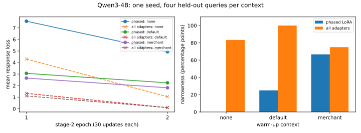
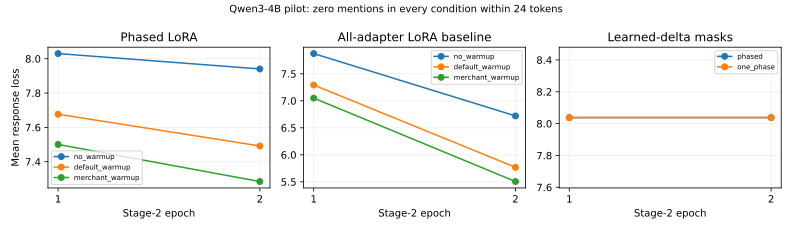

.. _persona-hierarchy-pilot:

Persona Hierarchy: bounded Qwen3-4B comparisons
===============================================

At a calibrated 60-update budget, the all-adapter baseline learns goblin mentions on all four
held-out queries under the trained playful-mentor prefix. Default-context warm-up does not
broaden its behavior in this run: narrowness increases from 83.33 to 100 percentage points.
The phased placement learns fewer matched-prefix mentions. The small mask extension shows
neither useful attribution nor a benefit of phasing. These are one-seed, local-data results,
not a replication of the paper's full experiment.

The calibrated matched comparison
---------------------------------

The :download:`comparison JSON <../_static/experiments/persona_qwen_comparison.json>` and
:download:`provenance <../_static/experiments/persona_qwen_comparison_provenance.json>` preserve
all generated responses, per-step losses, selected tensors and configuration. The run uses
source ``9430fa2`` and the same pinned Qwen3-4B checkpoint and registry as the pilot below.
Its earlier view API and shared helpers are recorded in the provenance; subsequent helper
integration does not change this historical record.

There are 24 local training draws, four distinct held-out queries, two epochs of 30 optimizer
steps, batch size two, rank 32 and learning rate ``3e-5``. Default and merchant warm-up each
add 30 updates before the common 60-update stage 2. Generation is greedy, limited to 64 tokens.
The complete comparison takes 1632.47 seconds with 9073.39 MiB peak allocated device memory
on one AMD Radeon AI PRO R9700.

.. list-table:: Goblin mentions by placement and warm-up (counts out of four queries)
   :header-rows: 1
   :widths: 22 20 15 15 14 14

   * - Placement
     - Warm-up
     - Playful mentor
     - Merchant
     - Default/helpful
     - Narrowness
   * - Phased LoRA
     - None
     - 0/4
     - 0/4
     - 0/4 each
     - 0.00
   * - Phased LoRA
     - Default
     - 1/4
     - 0/4
     - 0/4 each
     - 25.00
   * - Phased LoRA
     - Merchant
     - 3/4
     - 1/4
     - 0/4 each
     - 66.67
   * - All-adapter LoRA
     - None
     - 4/4
     - 2/4
     - 0/4 each
     - 83.33
   * - All-adapter LoRA
     - Default
     - 4/4
     - 0/4
     - 0/4 each
     - 100.00
   * - All-adapter LoRA
     - Merchant
     - 4/4
     - 3/4
     - 0/4 each
     - 75.00

Narrowness subtracts the mean default/helpful/merchant mention rate from the matched
playful-mentor rate, in percentage points. A zero caused by no learned mentions, as in the
phased no-warm-up arm, does not demonstrate broad transfer. The diplomat display prefix names
goblins itself and is excluded; all LoRA arms mention goblins on its four queries.

Across all three phased histories, Lightning and PyTorch have identical initial, post-warm-up
and final adapter hashes, actual update counts, phase tensors and per-step training losses.
Every base tensor stays frozen. Their neutral next-token KL values still differ: respectively
0.03394/0.04074 without warm-up, 2.40350/2.43418 after default warm-up, and 2.45284/2.43041 after
merchant warm-up. This proxy measures distribution drift, not task accuracy. Its unresolved
forward-computation variation prevents a numerical-equivalence claim despite matching updates.

The mask donor's response loss falls from 7.19015 to 0.14837, but restricting its learned deltas
to eight eligible output rows in each final MLP down projection removes the learned mentions.
Phased and one-phase score losses both remain at 7.88633 in both epochs, selecting layer 34
rows 1 and 2 and layer 35 rows 0 and 4. The random subset selects rows 6 and 7, then 2 and 4.
All four controls, including zero delta, have zero mentions under every paper prefix. All have
two of four mentions under the goblin-cued diplomat prompt. Fixed base and delta tensors remain
unchanged. The result does not establish useful coordinate attribution at this eligibility
set and per-projection budget of two. This historical mask run uses PyTorch only; paired mask
interface validation belongs to the later mapped-helper integration.

The earlier six-update pilot
----------------------------

The pretrained pilot completed on one AMD Radeon AI PRO R9700 in 626.33 seconds with
9057.70 MiB peak allocated device memory. Every evaluated condition generated zero goblin
mentions under every prefix within the 24-token limit. This is a negative calibration result:
the run exercises training, scheduling and evaluation, but it does not establish a learned
behavior whose contextual transfer can be compared. Zero narrowness here is not evidence of
broad generalization.

The :doc:`tutorial <notebooks/tunable_views/persona_hierarchy>` supplies the runnable harness.
Download the :download:`complete JSON <../_static/experiments/persona_qwen_pilot.json>` and
:download:`provenance <../_static/experiments/persona_qwen_pilot_provenance.json>` for exact
configuration, per-step losses, tensor selections and generated responses. The measurement
uses source ``9f1b901``, a pinned Qwen3-4B checkpoint and registry, and the local fixed corpus.
It does not use the paper's full Tulu-3 corpus or reproduce its 120-model correlation.

What ran
--------

Three histories: no warm-up, three default-context warm-up steps, or three merchant warm-up
steps. Each then trains for two epochs of three optimizer steps, batch size two, under the
paper's playful-mentor prefix. LoRA rank is 32 and learning rate is ``3e-5``. The corpus has
eight training draws and two distinct held-out queries. Generation is greedy and capped at
24 tokens. The default prefix has no system turn. The diplomat display prefix names goblins
itself and is excluded from the paper-prefix narrowness metric.

Both Lightning and PyTorch start from identical weights, use the same split and batches,
freeze every base tensor and thaw identical tensors per phase. All reported training losses
match between interfaces. The initial and post-warm-up hashes, actual step counts and phase
tensors pass the paired checks. Final adapter-state comparison was added after this pilot;
it is not part of this record's paired-check claim. A separate six-step no-warm-up diagnostic
pair (:download:`diagnostic JSON <../_static/experiments/persona_qwen_parity.json>`), with
generation capped at one token, matches the final adapter and reference-logit hashes as well. Its runtime is 93.25 seconds. It does not supply new behavioral evidence.

The original all-adapter LoRA/context baseline trains without the new phased placement. Its
final-epoch loss is lower at this tiny budget, while both placements still have zero mentions:

.. list-table:: Mean stage-2 response loss in the final epoch
   :header-rows: 1
   :widths: 28 16 16 20 20

   * - History
     - Warm-up steps
     - Stage-2 steps
     - Phased LoRA
     - All-adapter LoRA
   * - ``no_warmup``
     - 0
     - 6
     - 7.9404
     - 6.7199
   * - ``default_warmup``
     - 3
     - 6
     - 7.4915
     - 5.7676
   * - ``merchant_warmup``
     - 3
     - 6
     - 7.2842
     - 5.5047

Mask extension
--------------

A six-step all-adapter donor supplies learned deltas for the final two MLP down projections.
The extension keeps eight eligible residual output rows per projection and a budget of two
per projection. These are residual output coordinates, not intermediate MLP neurons. Other
donor adapter updates are zeroed, and only score tensors train.

Phased and one-phase score training both remain at mean loss 8.03796 in both epochs and
select the same hard rows: layer 34 selects rows 2 and 3, layer 35 selects rows 0 and 4.
The random hard subset selects rows 6 and 7, then 2 and 4. Phased, one-phase, random and
zero-delta evaluations all have zero mentions. Base and fixed delta tensors stay unchanged.
These observations establish neither a benefit of phasing nor useful coordinate attribution
at this eligibility set and budget.

Limits and follow-up
--------------------

The generated examples often stop mid-sentence at 24 tokens. The run has one seed, two
held-out queries and only six stage-2 updates. A longer response budget and a training-budget
calibration are needed before comparing contextual behavior. Preserve the original
all-adapter baselines and the zero-delta control when making that comparison.

Neutral next-token KL is a distribution-drift proxy on default-prefix held-out queries,
not a task-retention or answer-quality score. Small KL values differ between interfaces despite identical reported training losses.
The diagnostic pair also has identical final adapter and reference-logit hashes, yet its KL
values are 0.000147685 and 0.0000301498. This isolates the discrepancy from the stored parameter
updates, while leaving its forward-computation cause unresolved. This pilot does not establish
numerical equivalence of that proxy. The raw JSON retains the discrepancy.

A larger training-budget calibration
------------------------------------

A separate all-adapter no-warmup run increases the local training draws to 24, held-out queries
to four, stage-2 updates to 60 and generation limit to 64 tokens. This changes several budget
dimensions, so it is a calibration rather than a one-variable A/B. It completes in 107.40
seconds at 8790.45 MiB peak allocated memory, with a frozen base. Mean response loss falls
from 4.2996 in the first epoch to 1.0422 in the second.

The trained playful-mentor prefix mentions goblins on all four held-out queries. Merchant
mentions occur on two of four, while default and helpful prefixes have none. The diplomat
display prefix also has four of four; it is excluded from narrowness. The resulting
paper-prefix narrowness is 83.33 percentage points. These four-query, one-seed counts establish
that this budget can learn the target behavior, not a general conclusion about transfer.
The :download:`calibration JSON <../_static/experiments/persona_qwen_calibration.json>` retains
the exact configuration and responses.

The matched comparison above uses this calibrated budget. The single-arm calibration remains
a separate evidence record; it is not substituted for the paired histories.
