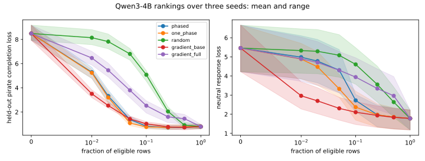

.. _selective-pirate-results:

The selective pirate: pretrained Qwen3-4B results
=================================================

A LoRA donor on Qwen3-4B learns an invented catchphrase, "By my pocket kraken!", and in doing so mostly loses
its answers. Across three seeds, the full delta produces the phrase in 12 of 12 held-out pirate responses
and the right answer's marker in 1 of 12: it says "Arrr, A seat is a seat. By my pocket kraken!" whatever you
ask. A learned 5% of the delta's rows keeps the phrase in 11 of 12 and the marker in
9 of 12 (phased) or 6 of 12 (one-phase). A random row subset
needs about half the rows to do the same. The phrase never appears on a neutral prompt, at any budget.

Those are small counts on a local corpus, with a marker chosen after reading the responses. They show that this
method separates the behavior from the damage in this bounded setting. They do not reproduce the paper's numbers,
and they do not establish that phased score training helps.

The :doc:`tutorial <notebooks/tunable_views/selective_pirate>` supplies the runnable harness. Download the
:download:`paired run <../_static/experiments/pirate_qwen_paired.json>`, the sweeps for seeds
:download:`1 <../_static/experiments/pirate_qwen_sweep_s1.json>`,
:download:`2 <../_static/experiments/pirate_qwen_sweep_s2.json>` and
:download:`3 <../_static/experiments/pirate_qwen_sweep_s3.json>`, and the
:download:`provenance <../_static/experiments/pirate_qwen_provenance.json>` for exact configuration, per-step losses,
budgets, selected rows, overlaps and every generated response.

What ran
--------

The donor trains rank-8 LoRA adapters for 60 updates (batch size 2, learning rate ``3e-4``) on the query and MLP up
projections of the last four blocks, with the base frozen. Mask scores then train for 60 updates at uniformly sampled
global budgets over the 55,296 eligible output rows. A percentage below is of those rows, not of the model's
parameters. Five rankings share each donor: ``phased`` (three score phases, the MLP up projections first, then
attention by address), ``one_phase`` (every score throughout, the same budgets), ``random``, and negative gate
gradients at the base and donor endpoints (``gradient_base``, ``gradient_full``, with 60 backward passes each).

The sweep uses three seeds, which change the LoRA initialization, the budgets and the split, with four held-out
questions per seed, on the PyTorch API. Each took about seven minutes at 8065 MiB peak allocated memory on one AMD
Radeon AI PRO R9700. Generation is greedy, capped at 48 tokens. A separate paired run with two held-out questions drives
both interfaces.

Rankings at matched budgets
---------------------------

.. list-table:: Catchphrase, then answer marker, out of 12 pirate responses per budget
   :header-rows: 1
   :widths: 22 13 13 13 13 13 13

   * - Ranking
     - 1%
     - 2%
     - 5%
     - 10%
     - 25%
     - 50%
   * - ``phased``
     - 0, 11
     - 0, 10
     - 11, 9
     - 12, 6
     - 10, 5
     - 11, 1
   * - ``one_phase``
     - 0, 10
     - 0, 10
     - 11, 6
     - 10, 2
     - 12, 4
     - 12, 0
   * - ``gradient_base``
     - 0, 7
     - 0, 9
     - 5, 8
     - 3, 6
     - 10, 5
     - 11, 3
   * - ``gradient_full``
     - 0, 9
     - 0, 9
     - 0, 9
     - 0, 8
     - 7, 9
     - 10, 8
   * - ``random``
     - 0, 8
     - 0, 8
     - 0, 8
     - 0, 9
     - 0, 7
     - 10, 8

At 0% the base model gives the phrase in 0 of 12 and the marker in 8 of 12. All full-delta endpoints are
exact: the masked model at every row reproduces the donor's logits with a maximum error of 0.0.

.. list-table:: Mean held-out pirate completion loss over three seeds
   :header-rows: 1
   :widths: 22 13 13 13 13 13 13

   * - Ranking
     - 1%
     - 2%
     - 5%
     - 10%
     - 25%
     - 50%
   * - ``phased``
     - 5.29
     - 3.32
     - 1.38
     - 0.82
     - 0.71
     - 0.74
   * - ``one_phase``
     - 5.24
     - 3.20
     - 1.09
     - 0.77
     - 0.73
     - 0.78
   * - ``gradient_base``
     - 3.50
     - 2.53
     - 1.43
     - 1.03
     - 0.77
     - 0.73
   * - ``gradient_full``
     - 6.47
     - 5.45
     - 3.79
     - 2.52
     - 1.60
     - 1.45
   * - ``random``
     - 8.14
     - 7.82
     - 6.80
     - 5.08
     - 2.05
     - 0.91

What this shows, and does not:

- **Loss and the behavior are different things.** ``gradient_base`` has the lowest loss at 1% and 2%, with no phrase at
  all. Its phrase count at 10% (3 of 12) is below its count at 5%
  (5 of 12), while its loss keeps falling. Its rows also lower neutral response loss far sooner than
  the learned rankings, so they look less selective on that measure.
- **The learned rankings find the phrase with few rows.** At 5% both have 11 of 12, against
  5 for ``gradient_base`` and none for ``gradient_full`` or ``random``. ``random``
  has none at 25%.
- **Answers fall as rows are added.** The marker count drops toward the donor's as the budget grows, for every
  ranking, though not monotonically. With 12 responses per point, read a difference of one or two as noise.
- **Phasing shows no clear benefit.** At 5%, ``one_phase`` has the lower mean loss and ``phased`` the higher marker
  count, 9 against 6 of 12. Phased selections are 92 to 97% MLP up rows at 5%, against 72 to 76% for one-phase and 70% of
  the eligible rows, which follows at least partly from those scores training first. Jaccard overlap between the two
  rankings is 0.62 to 0.72 at 5%, and 0.02 to 0.03 against random, which is chance.
- **Held-out loss at 25% is below the full delta on all three seeds**, for both learned rankings. This run does not
  explain why.

Retention
---------

Neutral prompts here are weak evidence. The phrase and pirate markers stay at zero on them throughout. The neutral
answer marker stays at 9 of 12 or better at every point. Next-token KL rises with the budget:

.. list-table:: Mean neutral next-token KL over three seeds
   :header-rows: 1
   :widths: 22 13 13 13 13 13 13

   * - Ranking
     - 1%
     - 2%
     - 5%
     - 10%
     - 25%
     - 50%
   * - ``phased``
     - 0.001
     - 0.003
     - 0.005
     - 0.012
     - 0.047
     - 0.077
   * - ``one_phase``
     - 0.001
     - 0.004
     - 0.019
     - 0.027
     - 0.064
     - 0.083
   * - ``gradient_base``
     - 0.010
     - 0.024
     - 0.026
     - 0.022
     - 0.037
     - 0.055
   * - ``gradient_full``
     - 0.001
     - 0.004
     - 0.006
     - 0.023
     - 0.049
     - 0.047
   * - ``random``
     - 0.000
     - 0.000
     - 0.000
     - 0.000
     - 0.003
     - 0.011

Neutral response loss falls as rows are added, from 5.46 at the base to 1.78 at the full delta. That is
not an improvement in retention. The neutral completions are terse local answers, so a lower loss can mean the model has
moved toward terse answers. Both measures are proxies, not a capability score.

Negative results along the way
------------------------------

- **Generic pirate language measures nothing here.** Addressed as a pirate, the base model already answers "Ahoy,
  matey!" in all 12 responses, so the generic marker is saturated before any training. The first calibration reported
  a large loss improvement that was only response-template fitting, hence the invented phrase.
- **The phrase needs the training budget.** At 20 donor updates it appeared in neither held-out response. At 60 it
  appeared in both.
- **Merging the delta failed.** A dense merged delta did not reproduce the donor in BF16: 6.2% of logits fell outside a
  0.02 tolerance, with a maximum error of 0.1875. The tolerance stayed, and the wrapper now keeps the two frozen factor
  multiplications.
- **An earlier Lightning record was on the wrong device.** Lightning's strategy teardown returns the module to CPU after
  ``fit``, so post-fit Lightning evaluations and gradient rankings first ran on CPU and differed from PyTorch's, over
  identical parameter bytes. The runner now restores the device and refuses to evaluate on another.

Interface parity and reproducibility
------------------------------------

In the recorded paired run, Lightning and the PyTorch API match exactly: initial and final states, phases, all
60 losses per stage, every evaluated metric and every generated response.

**Identical runs do not always reproduce on this hardware.** With the same code and initial state, a repeated sweep
reproduced seed 1 exactly while seeds 2 and 3 diverged from the second donor update. Nine repeats of a 12-update donor
gave one such divergence, also there, with a maximum loss difference of 0.013. The cause is unresolved, and other
hardware is untested. So exact parity is an observation about this record rather than a guarantee, and the runner reports training
and evaluation differences rather than raising on them. Between the two complete sweeps, a summed count moved by at
most 2 of 12 and one seed's loss by at most 0.098. All the 5% counts above were unchanged.

Limits
------

- One model, a twenty-question local corpus, and three seeds. This is not appendix J's Alpaca rewrite corpus or its
  model families, and no number from the paper is reproduced.
- Rates are lexical and greedy. A marker can appear in a wrong answer ("A compass don't point north and south by
  magic") and a right answer can be cut off at 48 tokens. Markers were chosen after reading responses, and the recorded
  answer rates were recomputed from the stored responses after three were widened to match inflections, so
  a held-out corpus with fixed markers would be a fairer test. Some responses degenerate into repeating the phrase.
- Only query and MLP up projections are eligible. Other projections need a different axis than this row wrapper offers.
- Row attribution ranks parts of one fixed delta. It does not localize behavior causally, and it says nothing
  about activation neurons in the base model.
- Phased score training is this tutorial's extension, and the paper does not make it.
